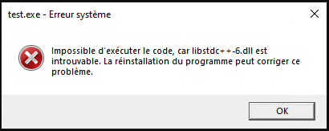
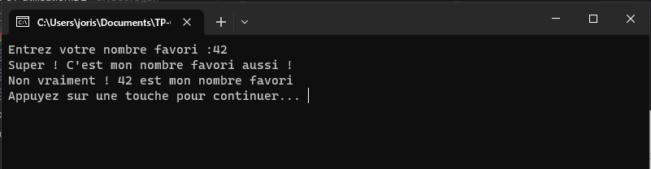
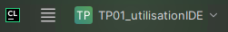
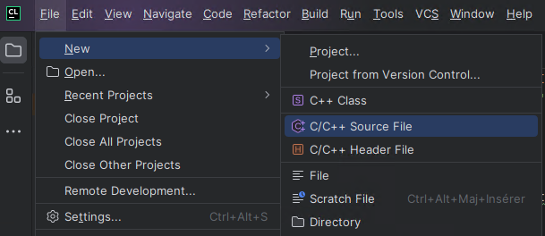
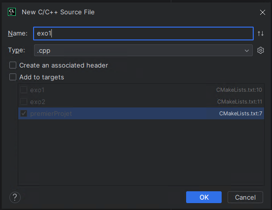
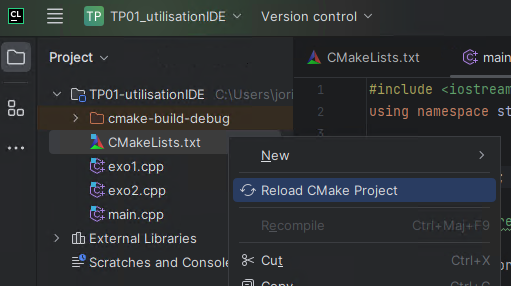
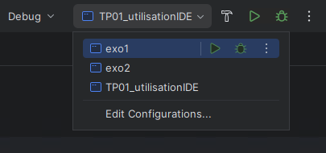
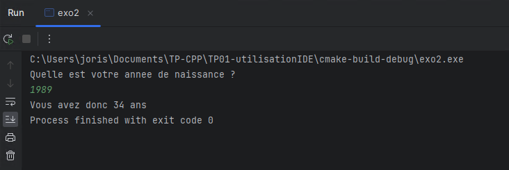

#  TP01 - Utilisation de l'IDE

Pour ce premier TP les cours suivants vous seront utiles :
- C01 - Introduction au C++
- C02 - C02 - Utilisation d'un IDE

🐙 Repository des cours de C++ : [ciel-ir-rascol/cpp-cours](https://github.com/ciel-ir-rascol/cpp-cours)

## 01 - Premier Programme
1. Créez dans *Mes Documents* un dossier `TP-CPP` dans lequel vous mettrez tous vos projet CLion au fil de l'année.
2. Lancez CLion et créez un nouveau projet dans votre dossier `TP-CPP`, vous appellerez ce projet `TP01-utilisationIDE`.<br>Le chemin de votre projet devrait ressembler à : `C:\Users\votreNom\Documents\TP-CPP\TP01-utilisationIDE`
3. Dans le fichier `main.cpp` supprimez le code *Hello World!* et copiez-collez le code suivant :
    ```cpp
    #include <iostream>
    using namespace std;
    
    int main(){
        int nbFavori;
        
        cout << "Entrez votre nombre favori :";
        
        cin >> nbFavori;

        cout << "Super ! C'est mon nombre favori aussi !" << endl;
        cout << "Non vraiment ! " << nbFavori << " est mon nombre favori"; << endl;

        return 0;
    }
    ```
4. Exécutez le programme en cliquant sur *Run* ▶︎ et vérifiez le bon fonctionnement.


## 02 - Exécutable Windows
### Erreur du linker
CLion crée un fichier `TP01-utilisationIDE.exe` lors de la construction du programme, c'est l'exécutable de votre code compilé pour votre machine. <br>Ce fichier ce situe dans votre dossier projet : `TP01-utilisationIDE/cmake-build-debug/TP01-utilisationIDE.exe`

Une erreur peut apparaître quand vous essayez de lancer le .exe : <br>


Dans ce cas modifiez le fichier CMake : `CMakeLists.txt` et ajoutez la ligne suivante :
```cmake
set(CMAKE_EXE_LINKER_FLAGS "-static")
```
Relancez la construction du programme en cliquant sur build 🔨 et exécutez à nouveau le fichier `TP01-utilisationIDE.exe`, à présent le programme devrait s'exécuter sans erreur dans une console windows.

### Mettre une pause
Vous avez pu remarquer que la console Windows se ferme automatiquement après que vous ayez tapé votre nombre préféré et appuyé sur Enter. Impossible de voir la suite du programme !

Nous allons donc mettre une pause à la fin du code afin de demander à l'utilisateur de taper sur une touche pour fermer la console :

```cpp
// À placer dans le main() juste avant le return 0
system("pause");
```
À présent nous pouvons voir le résultat de notre programme et appuyer sur une touche pour fermer la console :




## 03 - Plusieurs fichiers .cpp
Jusqu'à présent tout notre code est dans un seul fichier : `main.cpp` or, les TPs de cet enseignement vont que très rarement comporter qu'un seul exercice, on va donc apprendre à créer plusieurs fichiers .cpp dans un projet et indiquer à l'IDE lequel compiler.

### Modification du fichier CMake
Ouvrez le fichier `CMakeLists.txt` et ajoutez 2 fichiers .cpp  à l'aide de `add_executable()` :
```cmake
cmake_minimum_required(VERSION 3.26)
set(CMAKE_EXE_LINKER_FLAGS "-static")
project(TP01-utilisationIDE)

set(CMAKE_CXX_STANDARD 17)

add_executable(TP01-utilisationIDE main.cpp)

# Nouveaux fichiers .cpp
add_executable(exo1 exo1.cpp)
add_executable(exo2 exo2.cpp)
```

### Ajout des fichiers .cpp
- En haut à gauche de l'IDE appuyez sur le burger (4 traits horizontaux) pour faire apparaître le menu : 
- Puis *File* ▶️ *New* ▶️ *C/C++ Source File* : <br>
- Décochez l'option *Add to targets* et appuyez sur *OK* <br>
- Pour finir rechargez le CMake du projet : Clic-Droit sur le fichier `CMakeLists.txt` puis *Reload CMake Project* : <br>
- À présent vous pouvez choisir le fichier à compiler dans le menu en haut à droite de l'IDE :<br>

## 04 - Petits exercices ...
### Espace de nom
- Copiez le contenu de `main.cpp` que vous avez modifié au début du TP et collez-le dans votre nouveau fichier `exo1.cpp`
- Comme dans le [cours d'introduction](https://github.com/ciel-ir-rascol/cpp-cours), supprimez la ligne `using namespace std;` et utilisez à chaque fois que nécessaire le *scope resolution operator*  `std::` pour spécifier l'utilisation de l'espace de nom standard.
- Changer le fichier à exécuter dans le menu en haut à droite de l'IDE, si ce n'est pas déjà fait.
- Lancez le programme et vérifiez la bonne exécution.

### Âge de l'utilisateur
- Ouvrez le fichier exo2.cpp et collez-y le squelette suivant :
    ```cpp
    #include <iostream>
    using namespace std;
    
    int main(){
        int anneeNaissance;
        // Mettez ici votre code
        
        return 0;
    }
    ```
- Modifiez le code afin qu'il :
  - Demande à l'utilisateur son année de naissance et stocke le résultat dans `anneeNaissance`
  - Affiche l'âge (théorique bien entendu car on ne connaît pas le mois ni le jour ...) de l'utilisateur en utilisant l'opérateur `-` et l'année actuelle.

Exemple de sortie console :<br>
